# Resume Intelligence

**Explainable resume screening for recruiters, and honest resume coaching for candidates.**

**Live demo: [resume-intelligence-hg1g.onrender.com](https://resume-intelligence-hg1g.onrender.com)**: click *Try with sample data*, no signup. (Free hosting: the first load can take 30–60 seconds.)

[](https://github.com/OmkarG-Star/AI-resume-analyzer/actions/workflows/ci.yml)


Most "resume analyzers" return one similarity percentage. Recruiters cannot act on a number, and candidates cannot fix one.
This tool returns **a decision with reasons**: who to shortlist, why, what to check in the interview, and, for candidates,
exactly which changes raise their score and by how much.

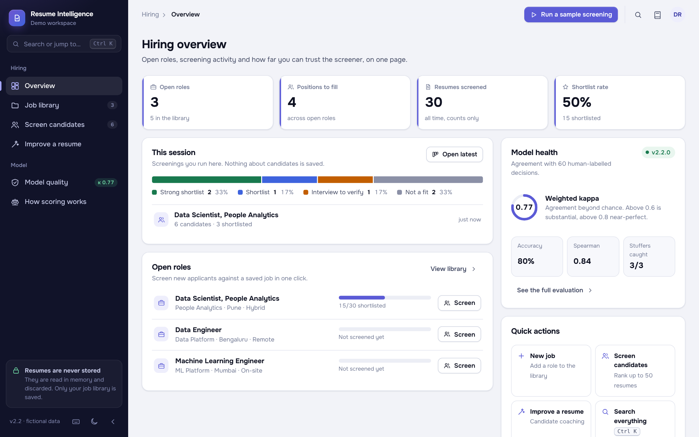

| Recruiter board | Insights for the pool |
|---|---|
| 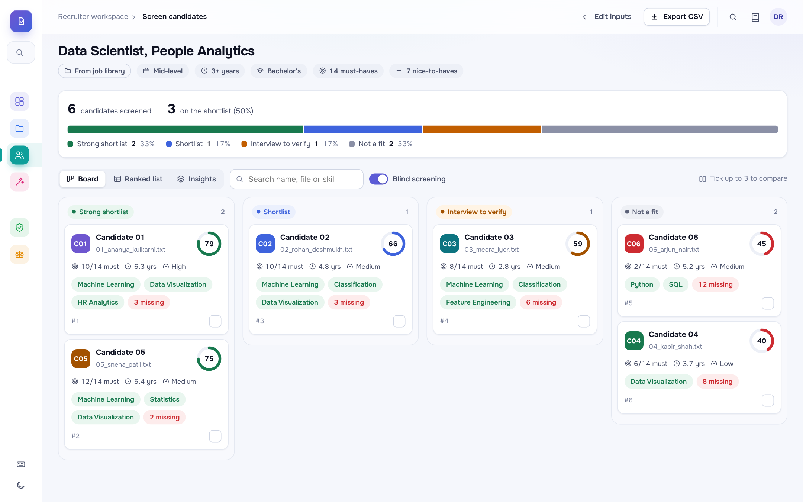 | 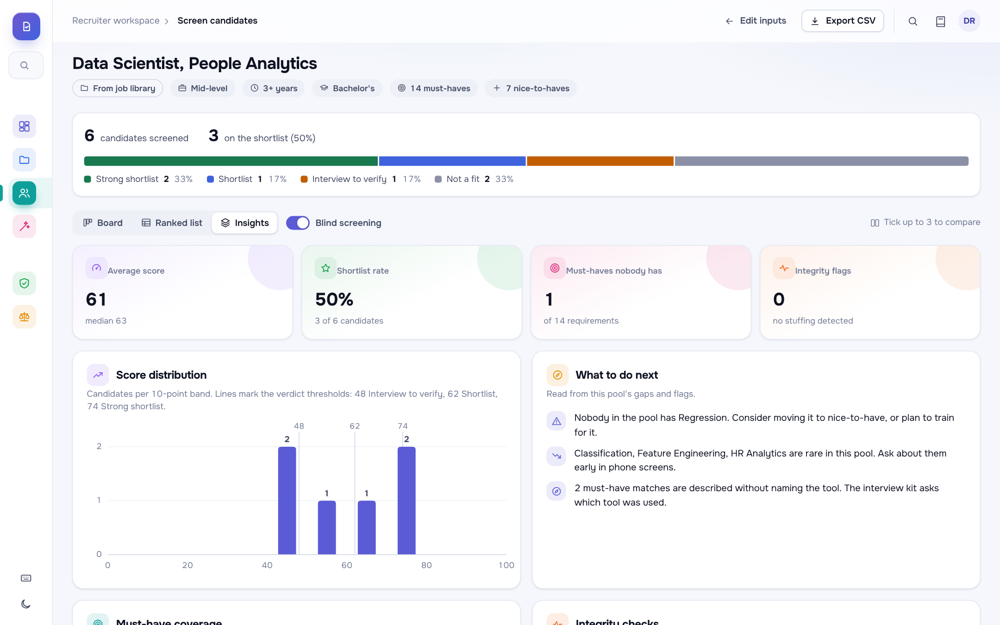 |
| **Candidate decision** | **Model quality** |
| 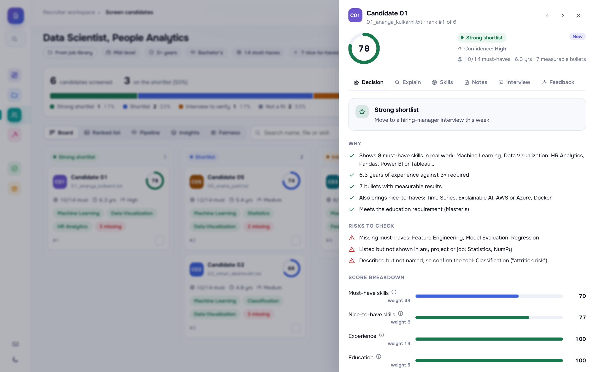 | 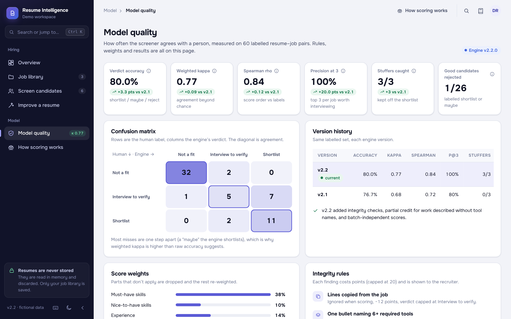 |
| **Explain this score** | **Pipeline with notes** |
| 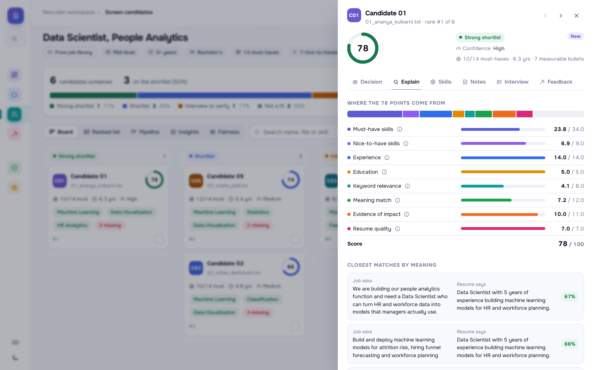 | 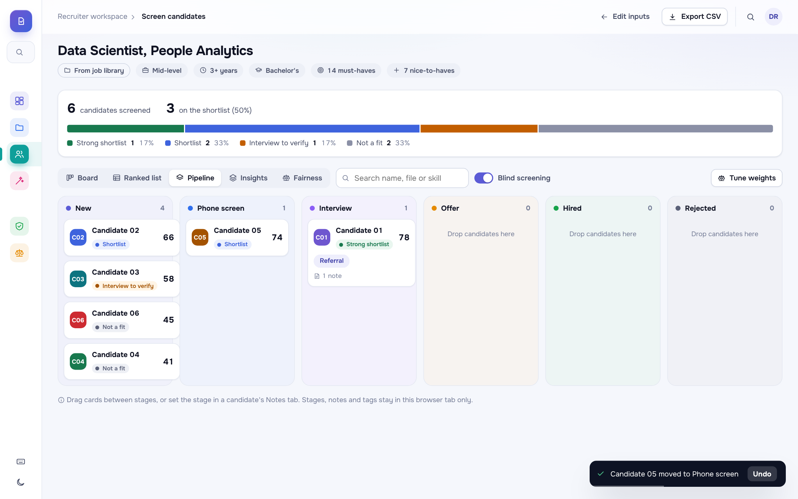 |
| **Fairness audit** | **Tune weights** |
| 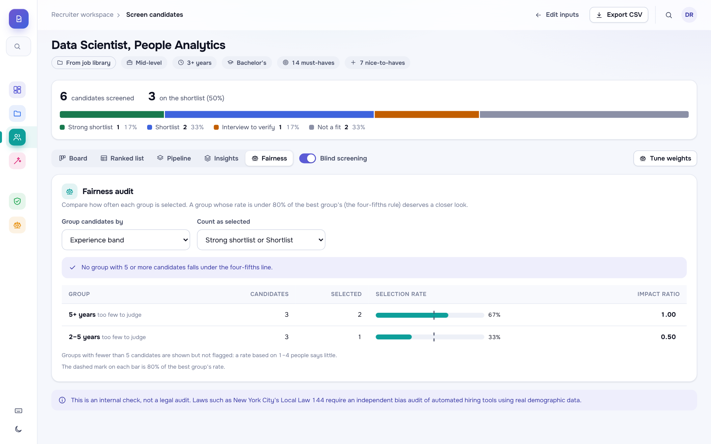 | 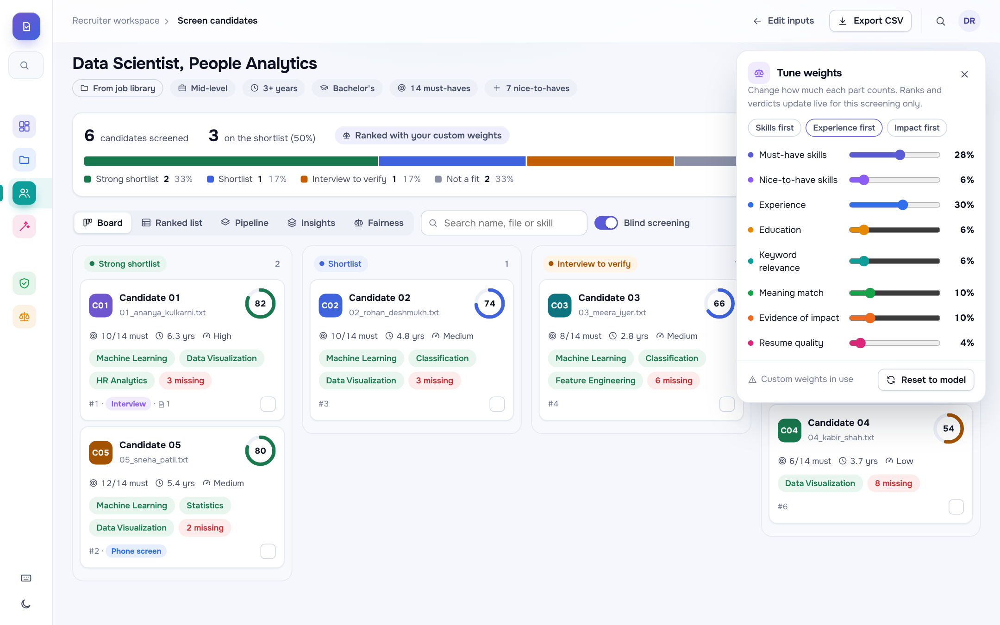 |
| **Candidate coaching** | **Ranked list** |
| 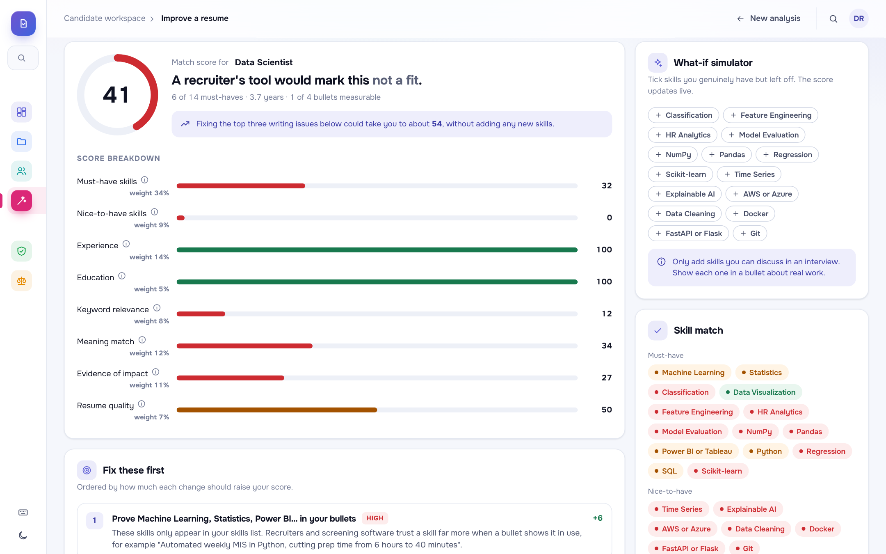 | 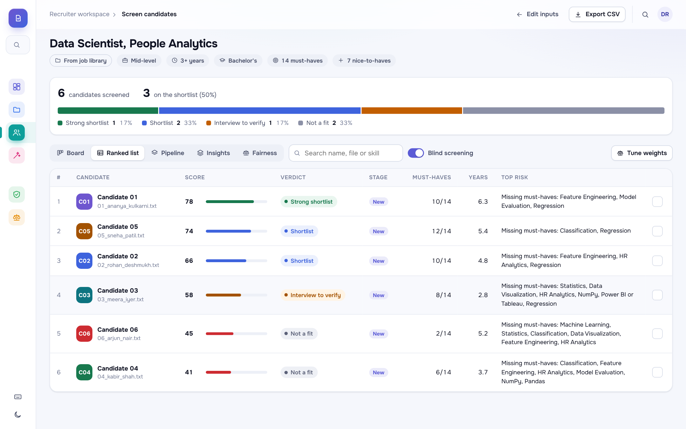 |

*All people, companies and resumes in the demo are fictional.*

---

## Workspaces

### Overview
- Open roles, positions to fill, resumes screened and shortlist rate across the job library.
- **This session**: every screening you run, with its verdict mix. Nothing about candidates is saved.
- **Model health**: live agreement with the labelled set, so recruiters know how far to trust the verdicts.
- **Command palette** (`Ctrl K` / `⌘ K`): jump to any page, job or candidate, or run an action. Press `?` for all shortcuts.

### Company: job library
- One place for every role the company is hiring for: **create, edit, duplicate, close or delete** job descriptions.
- Each job keeps its team, location, employment type, hiring manager, openings and status (**Open · On hold · Closed**).
- **Live requirement preview** while you write: see the must-haves, nice-to-haves and minimum experience the screener will use, with warnings when a description has no clear requirements or too many must-haves.
- **Screen candidates against a saved job in one click.** Each screening adds to the job's counts (screenings, resumes screened, shortlisted).
- Filter by status, search by title, team, location or skill.
- Only job descriptions and counts are saved (SQLite, `JOBS_DB`); resumes are never stored.

| Job library | Job editor with live preview |
|---|---|
| 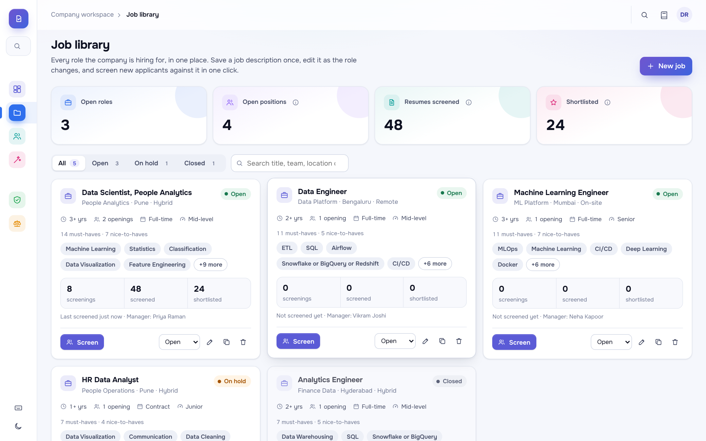 | 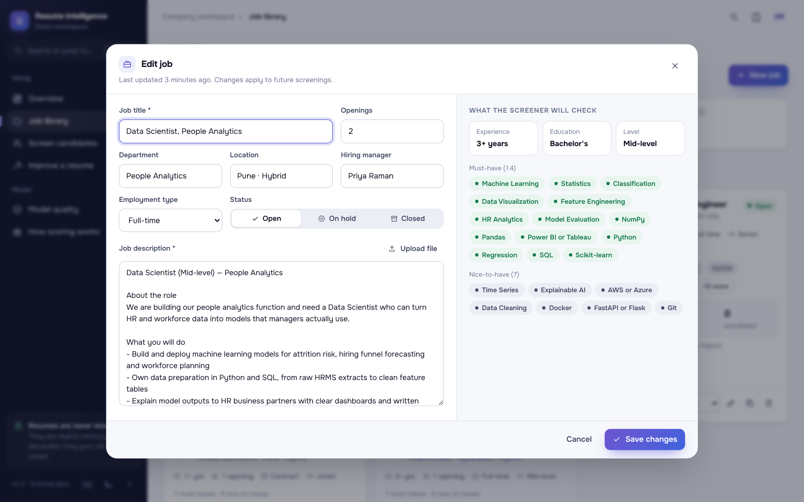 |

### Recruiter: screen candidates
- Upload a job description and up to 50 resumes (**PDF, DOCX, TXT**).
- Every candidate gets a verdict: **Strong shortlist · Shortlist · Interview to verify · Not a fit**, with the knockout rules that triggered it.
- **Why** and **Risks to check** in plain sentences, plus an 8-part score breakdown.
- **Explain this score**: where every point came from, the closest job-to-resume matches by meaning, and the resume with matched skills, listed-only skills, described-not-named work and measurable results highlighted.
- **Pipeline**: drag candidates through New → Phone screen → Interview → Offer → Hired / Rejected, with **notes** and **tags** (kept in the browser tab only).
- **Fairness audit**: selection rates and impact ratios by experience band, education, resume length or groups you assign, flagged against the four-fifths rule.
- **Tune weights** with sliders or presets; ranks change live with an arrow showing who moved, and one click resets to the model.
- **Click any number** (KPIs, pipeline counts, model metrics) for a pop-up with the detail behind it.
- **Remove** candidates, notes, tags, resumes and session history, each with **Undo**.
- **Interview kit**: questions written from that person's gaps ("Your resume lists Tableau but no project shows it…").
- **Candidate feedback** you can paste into a reply, whatever the decision.
- A **verdict pipeline bar** over three tabs: **Board** (Kanban by verdict), **Ranked list** and **Insights** (keys `1` `2` `3`).
- **Insights**: score distribution against the verdict thresholds, recommended next steps, must-have coverage (rarest first), integrity flags and the skill heatmap.
- **Integrity flags** on cards that look written for screening software, with the reasons in the drawer.
- Step through candidates with `←` `→`, **compare up to 3** side by side, **CSV export**.
- **Blind screening on by default**: names are replaced by candidate IDs.

### Candidate: improve a resume
- Match score for a specific job, and how a recruiter's tool would classify you.
- **Fix these first**: changes ranked by their measured score gain.
- **Bullet rewrites** that turn "Responsible for preparing reports" into "Prepared reports — [add the result]", with placeholders instead of made-up numbers.
- **What-if simulator**: tick skills you genuinely have but left off and watch the score update.
- Job keywords you don't use, an ATS readiness checklist, and a skill match map.

---

## How the score works

| Part | Weight | What it measures |
|---|---|---|
| Must-have skills | 34 | Share of required skills found. **Shown in a job/project bullet = full credit; only in a skills list = 70%; work described without naming the tool = 40%.** |
| Experience | 14 | Years from dated roles (overlaps merged) vs the job's minimum |
| Meaning match | 12 | How closely the meaning of the resume's work lines matches the job's lines (MiniLM sentence embeddings) |
| Evidence of impact | 11 | Measurable results, action-verb bullets, skills demonstrated in context |
| Nice-to-have skills | 9 | Same as must-haves, for preferred skills |
| Keyword relevance | 8 | TF-IDF cosine similarity between resume and job (1–2 grams) |
| Resume quality | 7 | Contact details, standard sections, length, measurable bullets |
| Education | 5 | Highest level found vs required level |

Parts that don't apply (e.g. no education requirement) are dropped and the rest re-weighted. Recruiters can change the weights for a screening with **Tune weights**; ranks and verdicts update live.

**Meaning match.** A small sentence-embedding model (all-MiniLM-L6-v2, exported to ONNX, about 90 MB, run with onnxruntime: no PyTorch, so it fits a 512 MB server) compares every line of the job with the resume's work lines. It also spots must-have skills described in other words: a work line within 0.55 cosine similarity of a skill's description counts as *Described, not named*. If the model files are missing, the app falls back to keyword matching and says so on the Model quality page.

**Learned weights, adopted only when they win.** `python eval/train.py --write` fits the weights to the labelled set (squared hinge to each label's score band, pulled toward the hand-set weights) and tests them with leave-one-resume-out cross-validation. They are used only if they beat the hand-set weights on resumes the fit never saw. On the current 60 author-labelled pairs they don't (kappa 0.77 vs 0.79), so the hand-set weights stay; with real recruiter labels, re-running the script switches over automatically when learning helps.

**Reading the job.** Skills under *Requirements* are must-haves. Skills under *Nice to have*, or in sentences with "preferred", "bonus" or "a plus", are nice-to-haves. Skills that appear only in the duties count as nice-to-haves when the advert has an explicit requirements list. **"Power BI or Tableau" is one requirement**: either skill satisfies it.

**Described, not named.** "Orchestrated DAG-based workflows" is Airflow-type work, even if the resume never says Airflow. About 20 skills have plain-language patterns like this. A match earns 40% credit, is shown as *Described, not named*, and adds an interview question asking which tool was used. It never counts as full credit.

**Integrity checks.** A keyword scorer is easy to game, so three patterns are caught and explained:

| Pattern | What happens |
|---|---|
| Lines copied from the job description | Removed before scoring; −12 points |
| A bullet naming 6+ required tools at once | Its skills count as listed, not shown; −6 points |
| Stated years well above the dated roles ("12 years" with 2 years of dates) | Dated years are used; −4 points |

The penalty is capped at 20 points. Copied text or crammed bullets also cap the verdict at *Interview to verify*, so a person looks before deciding.

**Stable scores.** Word weights for the relevance part come from a fixed reference corpus, not from the uploaded batch. The same resume gets the same score whoever else is in the pool.

**Skills.** 96 canonical skills with 259 aliases across 9 categories (sklearn → Scikit-learn, Postgres → PostgreSQL), matched on token boundaries so "excellent" is not "Excel" and "mysql" is not "sql". Specific tools imply broader skills (PostgreSQL → SQL, PyTorch → Deep Learning).

**Verdicts.**

| Verdict | Rule |
|---|---|
| Strong shortlist | Score ≥ 74, at most 30% of must-haves missing, experience met |
| Shortlist | Score ≥ 62, at most a third of must-haves missing |
| Interview to verify | Score ≥ 48 |
| Not a fit | More than half the must-haves missing, or score < 48 |

**Gains are measured, not guessed.** Each suggestion's "+points" comes from re-scoring the resume with that one fix applied.

## How accurate is it?

Accuracy is measured against human labels in [`eval/`](eval/): a **development set** of 60 resume–job pairs (used to design the rules) and a separate **held-out set** of 21 pairs, written and labelled before the engine scored them and never used for tuning. Both include keyword stuffers, people who describe their work without naming tools, career changers and inflated claims.

| Metric | v2.1 | v2.2 | v2.3 |
|---|---|---|---|
| Verdict accuracy (shortlist / maybe / reject) | 76.7% | 80.0% | **90.0%** |
| Cohen's kappa (linear-weighted) | 0.68 | 0.77 | **0.88** |
| Spearman rho, score vs label | 0.72 | 0.84 | 0.84 |
| Precision@3 per job | 80% | 100% | 100% |
| Keyword stuffers kept off the shortlist | 0 of 3 | 3 of 3 | 3 of 3 |
| Good candidates wrongly rejected | 1 of 26 | 1 of 26 | 1 of 26 |
| **Held-out set: accuracy / kappa** | — | 71.4% / 0.70 | **81.0% / 0.80** |

The held-out row is the fairer number. v2.3's gains come from meaning-based matching, treating soft skills as interview checks rather than must-haves, counting only roles that use the job's skills as experience (with relevant projects as partial credit), and requiring most of the experience for a shortlist.

The resumes are fictional and the labels are the author's, so treat these figures as a regression baseline, not a real-world accuracy claim. [`eval/README.md`](eval/README.md) explains how to measure it properly with recruiter labels. The main known weakness: adjacent profiles (for example a strong ML engineer applying for an HR data scientist role) can be rejected when more than half the must-haves are missing, where a recruiter would still phone-screen them.

---|---|---|
| Verdict accuracy (shortlist / maybe / reject) | 76.7% | **80.0%** |
| Cohen's kappa (linear-weighted) | 0.68 | **0.77** |
| Spearman rho, score vs label | 0.72 | **0.84** |
| Precision@3 per job | 80% | **100%** |
| Keyword stuffers kept off the shortlist | 0 of 3 | **3 of 3** |
| Good candidates wrongly rejected | 1 of 26 | 1 of 26 |

The resumes are fictional and the labels are the author's, so treat these figures as a regression baseline, not a real-world accuracy claim. [`eval/README.md`](eval/README.md) explains how to measure it properly with recruiter labels. The main known weakness is that years are counted from every dated role, including roles outside data work, so career changers can look more experienced than they are.

---

### Model quality
- Verdict accuracy, weighted kappa, Spearman, precision@3, stuffers caught and false rejections, each against the previous version.
- Confusion matrix, score weights, integrity rules and every disagreement with the labels, served live from `GET /api/model`.

## Responsible use

- **Decision support, not a decision.** Keyword-based scoring misses career changers, unusual titles and context. A person should review every rejection.
- **No personal attributes.** Name, gender, age, photo and address are never used. Blind mode hides names, and emails and phone numbers are masked in any quoted text.
- **Resumes are never stored.** Uploads are processed in memory and discarded, with no logging of resume content. The only database is the company job library: job descriptions plus screening counts.
- **Honest coaching.** The candidate view never suggests claiming skills you don't have, and rewrites use placeholders rather than invented numbers.

---

## Architecture

```
frontend/            single-page app: vanilla JS, hand-built SVG charts, no framework or CDN
  index.html
  assets/app.js      routing, overview, board/insights, model quality, drawer, palette, what-if, uploads
  assets/styles.css  design tokens (light/dark), components, motion
  assets/icons.js    outline icon set drawn for this project (MIT)
src/resume_ai/
  parsing.py         PDF/DOCX/TXT extraction, sections, years, education, PII masking
  skills.py          taxonomy, aliases, implications, plain-language "related" phrases, span matching
  integrity.py       copied job text, crammed bullets, inflated years claims
  jd.py              must-have / nice-to-have split, either-or groups, years, education, seniority
  engine.py          features, 8-part score, verdicts, reasons, questions, suggestions, rewrites, evidence spans
  semantic.py        MiniLM ONNX sentence embeddings (optional; falls back to keywords)
  evaluation.py      agreement with the labelled set (CLI and /api/model)
  store.py           job library: SQLite CRUD for job descriptions and screening counts
  api.py             FastAPI: analyze, screen, export, parse-file, /api/jobs CRUD
samples/             job descriptions, seed job library and 6 fictional resumes
eval/                labelled resume-job pairs and evaluate.py (accuracy, kappa, Spearman)
tests/               42 pytest tests (parsing, skills, JD, engine, integrity, API, job library, eval baseline)
legacy/              the original Streamlit + TF-IDF version, kept for comparison
```

## Run it

```bash
git clone https://github.com/OmkarG-Star/AI-resume-analyzer.git
cd ai-resume-analyzer
pip install -r requirements.txt
python scripts/fetch_model.py          # optional: the meaning-match model (~90 MB)
PYTHONPATH=src uvicorn resume_ai.api:app --reload
# open http://localhost:8000
```

Tests:

```bash
pip install pytest httpx reportlab
python -m pytest -q
python eval/evaluate.py   # agreement with the labelled set
```

Docker:

```bash
docker build -t resume-intelligence .
docker run -p 8000:8000 resume-intelligence
```

Deploy for free on Render: **New → Blueprint →** select this repo (`render.yaml` is included).

## API

```bash
curl -X POST localhost:8000/api/analyze -H 'content-type: application/json' \
  -d '{"resume": "…resume text…", "job": "…job description…", "assume_skills": ["Pandas"]}'
```

| Endpoint | Purpose |
|---|---|
| `POST /api/analyze` | One resume vs one job: score, verdict, suggestions, rewrites, ATS checks |
| `POST /api/screen` | Many resumes vs one job: ranked candidates, counts, skill coverage |
| `POST /api/screen/export` | The ranked shortlist as CSV |
| `POST /api/parse-file` | Extract text from a PDF, DOCX or TXT upload |
| `GET /api/samples` | Demo job descriptions and resumes |
| `GET /api/model` | Weights, verdict rules, integrity rules and agreement with the labelled set |
| `GET /api/jobs` · `POST /api/jobs` | List the job library (with parsed requirements) · add a job |
| `GET / PUT / DELETE /api/jobs/{id}` | Read, edit or remove a job |
| `POST /api/jobs/{id}/duplicate` | Copy a job as an On hold draft |
| `POST /api/jobs/preview` | Parse a description without saving it |

`POST /api/screen` also accepts `job_id` to record the screening against a saved job.

The library lives in SQLite at `JOBS_DB` (default `data/jobs.db`) and is seeded with five sample roles when empty. On hosts with a temporary filesystem, such as Render's free plan, it resets to those roles on restart; point `JOBS_DB` at a persistent disk to keep it.

## Version history

- **v2.3**: meaning-based matching (MiniLM, ONNX), a weight-learning pipeline with honest cross-validation, explain-this-score with a highlighted resume, pipeline stages with notes and tags, fairness audit, live weight tuning, clickable KPI pop-ups, delete with undo everywhere, and no public API docs page.
- **v2.2**: integrity checks against keyword stuffing, partial credit for work described without tool names, batch-independent scores, and an evaluation set with accuracy metrics. New console UI in a bright light theme: an icon-rail sidebar that expands on hover, colour-coded workspaces, overview dashboard, insights tab, model quality page, command palette, keyboard shortcuts and a staged screening run.
- **v2.1**: company job library: saved job descriptions with status, team and openings, live requirement preview, one-click screening and per-job counts.
- **v2.0**: rebuilt as a two-sided product: structured job parsing, evidence-weighted scoring, verdicts with reasons, interview kit, candidate coaching with measured gains, premium web UI, tests and CI.
- **v1.0** (`legacy/`): Streamlit app with TF-IDF cosine similarity and a fixed 28-skill list.

## License

MIT © 2026 Omkar Gadhave
